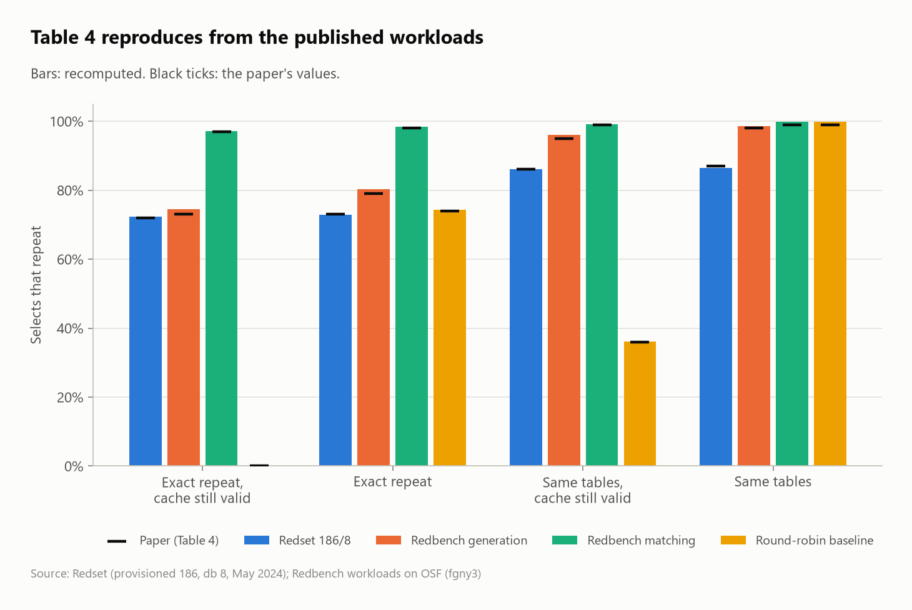
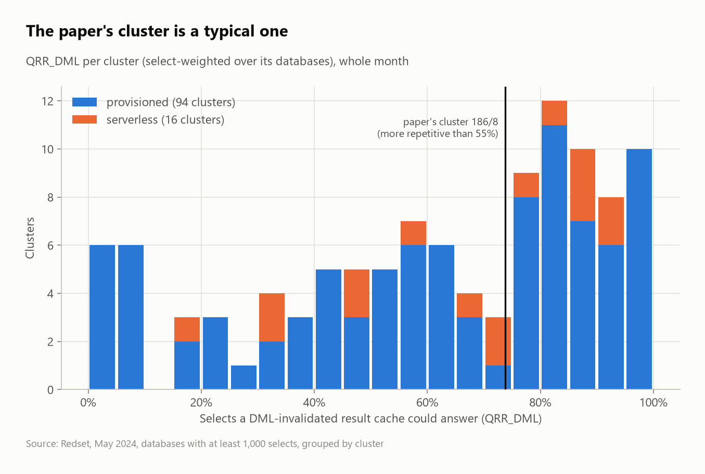
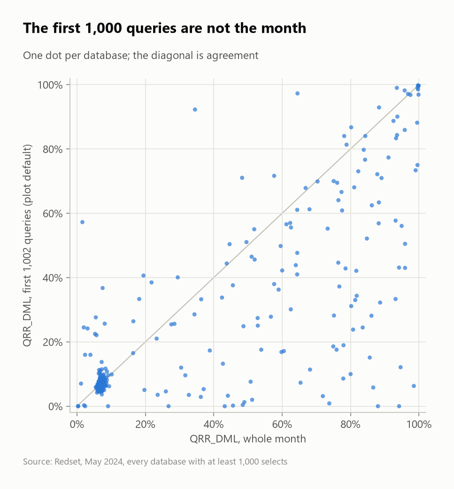
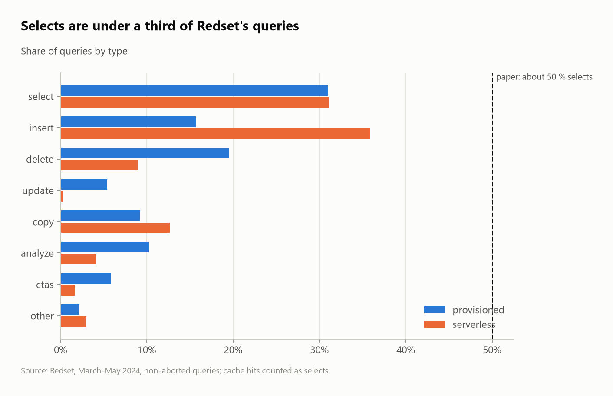
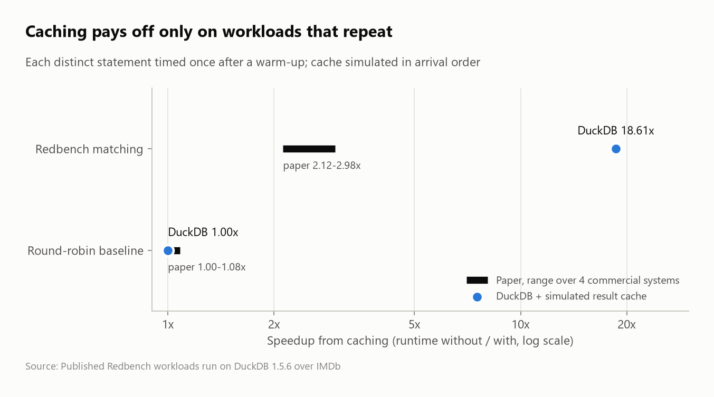

# Does Redbench copy Redset? Replicating a VLDB 2026 workload generator

In *Redbench: Workload Synthesis From Cloud Traces* (PVLDB 19, VLDB 2026), Wehrstein et al. build benchmark workloads that copy the **repetition, query mix and arrival times** of Amazon's Redset trace onto the IMDb database. They argue that TPC-style benchmarks hide what cloud warehouses really run (repeated queries, string filters, writes between reads) and show that caching pays off far more on their workloads.

**Question:** do the paper's numbers follow from its published artifacts, and do its claims about Redset hold beyond the one cluster it uses?

This project recomputes the paper's tables from the raw Redset trace and the three workloads the authors published, with code written from scratch (each repetition metric twice, in Python and in SQL, tested to agree). It then checks the paper's Redset claims on all 439 M queries and every May database, and replays the workloads on DuckDB with a simulated result cache.

🧠 **How it works and how to defend it:** [LEARN.md](LEARN.md)



## Results in one paragraph

**22 claims confirmed, 8 close, 5 not confirmed.** The paper's own numbers hold up:
- Table 4 reproduces from the published workloads to within 0.015 everywhere, and exactly for matching and the round-robin baseline.
- The paper's cluster is what it says: 36,353 queries, 24,881 selects, 6,405 distinct, 11,472 DML.
- Matching and generation keep every arrival time and query type of the trace.
- Table 5's string-filter shares come out at 69 % and 76 % (paper: 67 % and 75 %).

What it says about Redset as a whole does not all transfer:
- **Selects are 31 % of queries, not ~50 %.** They reach 43 % only after dropping COPY, ANALYZE and CTAS.
- **DELETE, not INSERT, is the largest DML type** in provisioned clusters (19.5 % vs 15.7 % of queries).
- **Runtime is more skewed than claimed.** The top 0.1 % of queries take 51 % of CPU time (proxy), not 25 %.
- **The paper's cluster is a typical one**, which the paper does not show: its QRR_DML (0.74) is close to the median cluster's (0.66) and above 55 % of the 110 clusters measured.

Two details explain apparent contradictions in the paper:
- **The round-robin baseline repeats as often as Redset** (QRR 0.74). The text says it has no repetitions because every repeat is invalidated by a write in between: QRR_DML = 0.00.
- **The authors' plotting code measures only the first 1,000 queries** by default. On the paper's cluster that gives a repetition rate near 1 % instead of 73 %.

On DuckDB with a simulated result cache, the ranking of §6 holds: **matching runs 18.6× faster with a cache, the round-robin baseline 1.00×** (paper: 2.12–2.98× and 1.00–1.08× on four commercial systems). DuckDB's speedup is much larger because a single-row write costs it ~5 ms, so almost nothing is left once 97 % of selects are cached; commercial systems pay a fixed overhead on every statement.

## Scorecard

Generated by `src/claims.py` from `results/`. Paper values are from its tables and text.

| § | Claim | Paper | Replication | Verdict |
|---|---|---|---|---|
| Table 4 | redset: QRR_DML | 0.72 | 0.72 | confirmed |
| Table 4 | redset: QRR | 0.73 | 0.73 | confirmed |
| Table 4 | redset: SRR_DML | 0.86 | 0.86 | confirmed |
| Table 4 | redset: SRR | 0.87 | 0.86 | confirmed |
| Table 4 | generation: QRR_DML | 0.73 | 0.74 | close |
| Table 4 | generation: QRR | 0.79 | 0.80 | close |
| Table 4 | generation: SRR_DML | 0.95 | 0.96 | confirmed |
| Table 4 | generation: SRR | 0.98 | 0.99 | confirmed |
| Table 4 | matching: QRR_DML | 0.97 | 0.97 | confirmed |
| Table 4 | matching: QRR | 0.98 | 0.98 | confirmed |
| Table 4 | matching: SRR_DML | 0.99 | 0.99 | confirmed |
| Table 4 | matching: SRR | 0.99 | 1.00 | confirmed |
| Table 4 | baseline_round_robin: QRR_DML | 0.00 | 0.00 | confirmed |
| Table 4 | baseline_round_robin: QRR | 0.74 | 0.74 | confirmed |
| Table 4 | baseline_round_robin: SRR_DML | 0.36 | 0.36 | confirmed |
| Table 4 | baseline_round_robin: SRR | 0.99 | 1.00 | confirmed |
| §5.2 | Cluster 186/8: queries | 36,000 | 36,353 | confirmed |
| §5.2 | Cluster 186/8: selects | 25,000 | 24,881 | confirmed |
| §5.2 | Cluster 186/8: distinct selects | 6,400 | 6,405 | confirmed |
| §5.2 | Cluster 186/8: DML | 11,000 | 11,472 | confirmed |
| Table 5 | Matching: string filter share | 67% | 69% | close |
| Table 5 | Generation: string filter share | 75% | 76% | close |
| §4.1 | Selects among queries (provisioned) | 50% | 31% | not |
| §4.3 | INSERTs among queries (provisioned) | 20% | 16% | close |
| §4.3 | INSERT is the largest DML type (provisioned) | insert | delete (20% of queries) | not |
| §4.1 | Selects among queries (serverless) | 50% | 31% | not |
| §4.3 | INSERTs among queries (serverless) | 20% | 36% | not |
| §4.3 | INSERT is the largest DML type (serverless) | insert | insert (36% of queries) | confirmed |
| §4.3 | Most INSERTs are INSERT ... SELECT (provisioned) | > 50% | 54% | confirmed |
| §4.3 | Most INSERTs are INSERT ... SELECT (serverless) | > 50% | 28% | not |
| §2.1 | CPU share of the top 0.1 % of queries (provisioned) | 25% | 51% | close |
| §2.1 | CPU share of the top 0.1 % of queries (serverless) | 25% | 39% | close |
| §6 (Fig 8) | baseline_round_robin: caching speedup | 1.00-1.08x | 1.00x (DuckDB, simulated result cache) | confirmed |
| §6 (Fig 8) | matching: caching speedup | 2.12-2.98x | 18.61x (DuckDB, simulated result cache) | close |
| §6 | Caching helps matching, not the round-robin baseline | yes | 18.61x vs 1.00x | confirmed |

## Repetition across the fleet



`src/clusters.py` measures every Redset database with at least 1,000 selects in May 2024 (302 databases in 110 clusters; one, provisioned 96/0, exceeded the spill cap). Three clusters hold 50 databases each with almost identical behavior, so the chart groups by cluster.



The authors' Fig 5 code (`plot_cluster_overview_plot.py`) stops after row 1,001 by default. For most databases the first 1,000 queries say little about the month.

## Query mix



## Caching on DuckDB



The paper's Systems A–D are not available. `src/run_execution.py` times every distinct statement of the matching (11,614) and round-robin (14,500) workloads on DuckDB 1.5.6 over IMDb, then replays all 36,353 statements in arrival order with a result cache that drops entries when a table they read is written.

| Workload | Selects served by the cache | Runtime without cache | With cache | Speedup |
|---|---|---|---|---|
| Matching | 97.1% | 59 min | 3.2 min | **18.6×** |
| Round-robin baseline | 0.0% | 296 min | 296 min | **1.00×** |

Each statement is capped at 60 s (26 baseline rows hit the cap). To check the simulation, the first 2,000 statements of each workload were run for real with an in-memory cache: the hits agree exactly, and the real cached runs took 12.5 s and 839 s against 10.7 s and 820 s simulated. The generation workload was not run: its SQL needs the authors' augmented IMDb copies (`title_0`, …), which could not be downloaded.

**Not reproduced:** the generator re-runs (and with them the determinism claim and Fig 5 on generated workloads). Running the authors' code was not approved in this environment; `src/rerun_generators.py` is ready. See [LEARN.md](LEARN.md) §7.

## Run it

```bash
python -m venv .venv && .venv/Scripts/pip install -r requirements.txt
```
```bash
git clone https://github.com/DataManagementLab/Redbench vendor/Redbench
```
```bash
.venv/Scripts/python src/run_sql.py sql/fleet.sql && .venv/Scripts/python src/table4.py && .venv/Scripts/python src/clusters.py
```
```bash
.venv/Scripts/python src/build_imdb.py && .venv/Scripts/python src/run_execution.py
```
```bash
.venv/Scripts/python src/claims.py && .venv/Scripts/python src/figures.py && .venv/Scripts/python -m pytest -q tests
```

The commands, in order:
1. Create the virtual environment and install the dependencies.
2. Get the authors' repository (for the IMDb schema and the JOB/CEB queries; its code is not run).
3. Fleet claims (one streaming pass each over the 17.7 GB Redset Parquet files), Table 4, and every May database (about an hour).
4. Build IMDb in DuckDB from the CWI CSVs, then time every distinct statement and simulate the cache.
5. Rebuild the scorecard and figures, run the tests.

Data needed in `data/`: Redset (`aws s3 cp --no-sign-request --recursive s3://redshift-downloads/redset/ ...`, path set in `src/redset.py`), the published workloads from [OSF fgny3](https://osf.io/fgny3/files) in `data/osf/<workload>/`, the paper's cluster extracted to `data/redset/c186_db8.parquet`, and `imdb.tgz` from CWI extracted to `data/imdb/raw/`.

| Folder | What's in it |
|---|---|
| `sql/` | `redset_cluster.sql` (Redbench's Redset preprocessing), `repetition.sql` (set-based QRR/SRR), `fleet.sql` (fleet claims, `-- name:` queries → `results/<name>.csv`) |
| `src/` | `repetition.py` (both authors' definitions), `table4.py`, `clusters.py`, `filters.py` (Table 5), `execute.py` (DuckDB + cache), `claims.py`, `figures.py` |
| `results/`, `figures/` | every number and chart |
| `tests/` | planted cases for each metric; SQL vs Python on random traces |
| `powerbi/` | Power BI dashboard over `results/` (see its README) |

## Credits and license

Paper: J. Wehrstein, R. Heinrich, M. Stoian, S. Krid, M. Stemmer, A. Kipf, C. Binnig, M. El-Hindi, *Redbench: Workload Synthesis From Cloud Traces*, PVLDB 19, 2026 ([arXiv 2511.13059](https://arxiv.org/abs/2511.13059)); code [DataManagementLab/Redbench](https://github.com/DataManagementLab/Redbench) (Apache 2.0). Data: [Redset](https://github.com/amazon-science/redset) by Amazon, **CC BY-NC 4.0**; IMDb snapshot from the JOB benchmark (CWI). No data is redistributed here; `results/` holds aggregates only.
